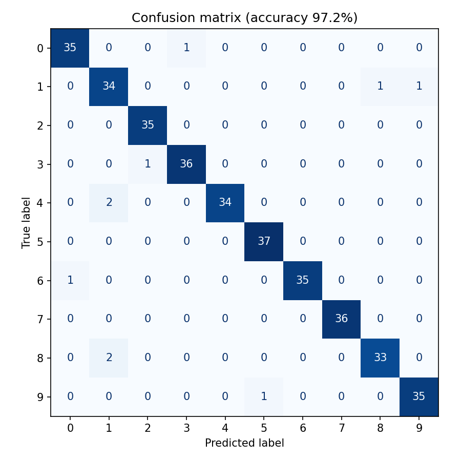
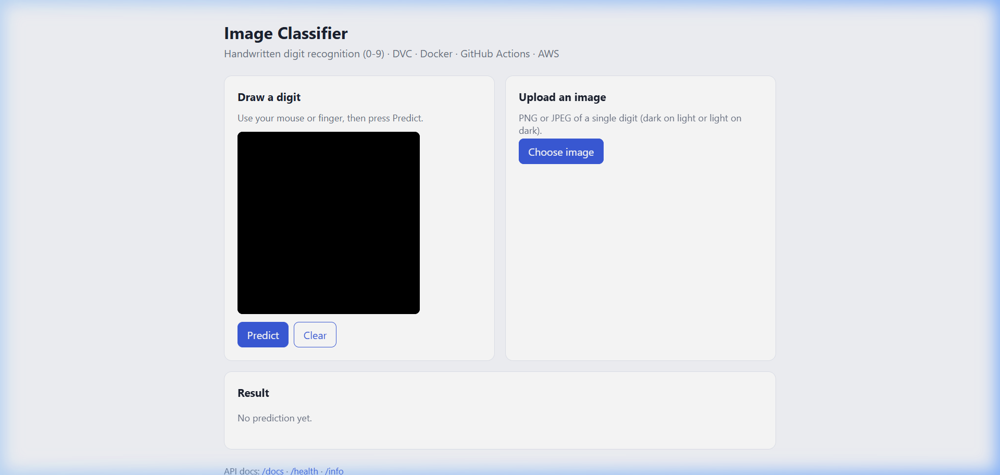
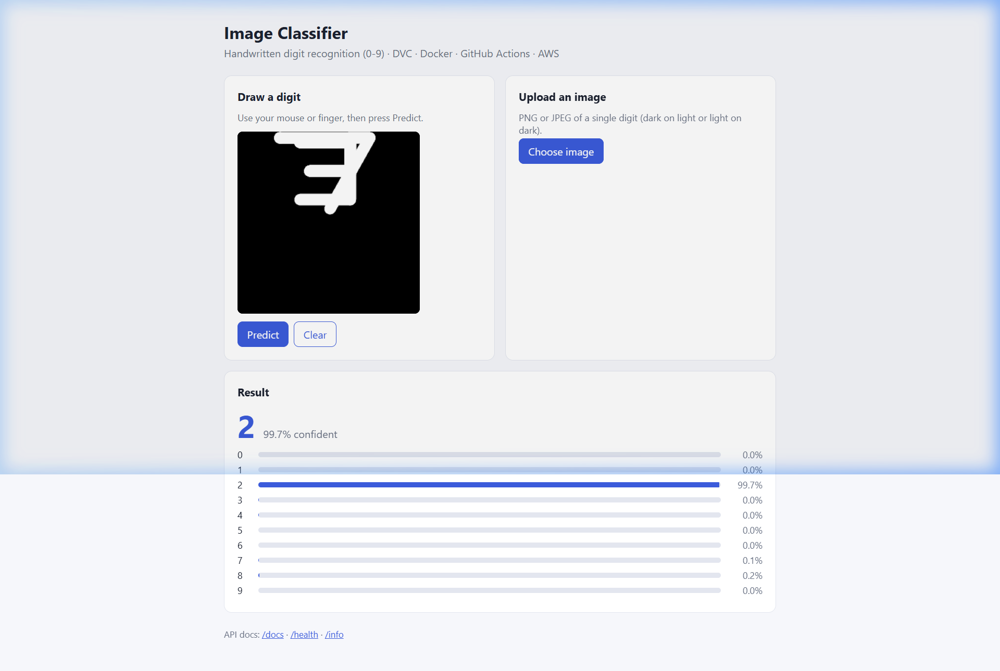
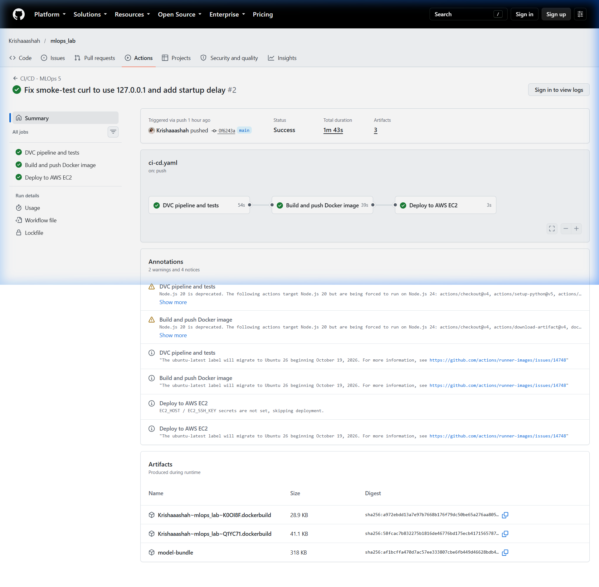

# Course Project Report: Production ML Pipeline with DVC, Docker, AWS & GitHub Actions CI/CD

---

## Student & Submission Details

- **Student Name**: Krisha Shah
- **PRN**: 24070126512
- **Course**: MLOps / Cloud Machine Learning Engineering
- **GitHub Repository**: [https://github.com/Krishaaashah/mlops_lab/tree/main/mlops_5](https://github.com/Krishaaashah/mlops_lab/tree/main/mlops_5)
- **GitHub Actions CI/CD Pipeline**: [Workflow Run #38736393369](https://github.com/Krishaaashah/mlops_lab/actions/runs/38736393369)
- **Live AWS EC2 Web Application**: [http://13.232.17.213](http://13.232.17.213)
- **Interactive API Documentation (Swagger)**: [http://13.232.17.213/docs](http://13.232.17.213/docs)
- **Target AWS Region**: `ap-south-1` (Mumbai)
- **AWS S3 Remote Storage**: `s3://image-classifier-dvc-ks-948215/dvcstore`
- **AWS EC2 Instance ID**: `i-09a2e2d2bd3f29168` (Public IPv4: `13.232.17.213`)

---

## 1. Executive Summary

This project implements an end-to-end Machine Learning Operations (MLOps) pipeline for an optical handwritten digit classifier. The architecture bridges model training, version control, automated testing, containerized packaging, cloud provisioning, and continuous deployment to AWS:

- **Data & Model Versioning**: Data Version Control (DVC) orchestrates the 4-stage ML pipeline (`prepare` → `preprocess` → `train` → `evaluate`) with remote storage backed by an encrypted **Amazon S3** bucket.
- **Serving Architecture**: A high-performance **FastAPI** web service serving predictions with confidence scores and probability distributions, featuring an interactive drawing canvas.
- **Containerization**: An optimized, secure **Docker** image running as an unprivileged user (`appuser`) with embedded health checks.
- **Cloud Infrastructure**: Scalable AWS infrastructure including private S3 bucket storage, least-privilege IAM policies, custom Security Groups, and an **Amazon EC2 (t3.micro)** instance running on Amazon Linux 2023.
- **CI/CD Automation**: A 3-tier **GitHub Actions** workflow (`pipeline` → `docker` → `deploy`) enabling zero-downtime automated deployment to EC2 upon every push to `main`.

---

## 2. Cloud Architecture Diagram

```
+-----------------------------------------------------------------------------------+
|                                 DEVELOPER WORKSPACE                               |
|                                                                                   |
|  [Code / Tests]       [dvc repro]       [dvc push]                                |
|         |                  |                 |                                    |
+---------|------------------|-----------------|------------------------------------+
          |                  |                 |
          v                  |                 v
+-----------------------+    |    +-------------------------------------------------+
|  GitHub Repository    |    |    |               AWS S3 REMOTE STORE               |
|  - .dvc/config        |    |    |  Bucket: image-classifier-dvc-ks-948215         |
|  - dvc.lock           |    |    |  Prefix: s3://.../dvcstore                      |
|  - .github/workflows/ |    |    |  - 1,801 objects (Raw data, train/test, model)  |
+-----------------------+    |    +-------------------------------------------------+
          |                  |                         ^
          | git push         +-------------------------+
          v
+-----------------------------------------------------------------------------------+
|                            GITHUB ACTIONS CI/CD RUNNER                            |
|                                                                                   |
|  1. Pipeline Job: dvc pull -> dvc repro -> dvc metrics show -> pytest             |
|  2. Docker Job  : docker build -> smoke test (/health) -> push ghcr.io            |
|  3. Deploy Job  : SSH into AWS EC2 -> docker pull -> docker run -p 80:8000        |
+-----------------------------------------------------------------------------------+
                                                               |
                                                               | SSH Deploy (Port 22)
                                                               v
+-----------------------------------------------------------------------------------+
|                        AWS EC2 INSTANCE (i-09a2e2d2bd3f29168)                     |
|                        Public IP: 13.232.17.213 | ap-south-1                      |
|                                                                                   |
|  +-----------------------------------------------------------------------------+  |
|  | Security Group (sg-05266645655d69bda)                                       |  |
|  | - Port 22 (SSH) : 0.0.0.0/0 (Automated CI/CD runner deployment)             |  |
|  | - Port 80 (HTTP): 0.0.0.0/0 (Public Web Traffic)                            |  |
|  +-----------------------------------------------------------------------------+  |
|                                                                                   |
|  Docker Engine (Active & Auto-restarting):                                        |
|  +-----------------------------------------------------------------------------+  |
|  | Container: image-classifier (Port 80 -> 8000)                                |  |
|  | - GET  /        : Interactive canvas web application UI                     |  |
|  | - POST /predict : Multi-part image classification endpoint                  |  |
|  | - GET  /health  : Container health monitoring endpoint                      |  |
|  | - GET  /docs    : Swagger OpenAPI specifications                            |  |
|  +-----------------------------------------------------------------------------+  |
+-----------------------------------------------------------------------------------+
```

---

## 3. Machine Learning Pipeline & DVC

The project adopts **Data Version Control (DVC)** to maintain strict reproducibility, decouple large binary datasets and models from git history, and enable caching.

### Pipeline Stages (`dvc.yaml`):
1. **`prepare`**: Converts the handwritten digits dataset into 1,797 upscaled PNG images organized into per-class directories under `data/raw/`.
2. **`preprocess`**: Center-crops, normalizes, and flattens images, partitioning them into stratified training (`data/processed/train.npz` - 1,437 samples) and testing (`data/processed/test.npz` - 360 samples) datasets with a reproducible seed (`42`).
3. **`train`**: Fits a Multi-Layer Perceptron (MLP) Classifier with hidden layer dimensions `(128, 64)`, L2 regularization `alpha=1e-4`, and maximum iterations `500`.
4. **`evaluate`**: Evaluates the trained artifact on the unseen test set, calculating class-level precision, recall, and F1 scores, and generating a confusion matrix.

### Pipeline DAG:
```
         +---------+      
         | prepare |      
         +---------+      
              *           
              *           
              *           
        +------------+     
        | preprocess |     
        +------------+     
          **        **     
        **            *    
       *               **  
+-------+               * 
| train |             **  
+-------+            *    
         **        **     
           **    **       
             *  *         
        +----------+      
        | evaluate |      
        +----------+      
```

### Metrics Achieved:
| Metric | Value | Samples Evaluated |
| :--- | :--- | :--- |
| **Test Accuracy** | **97.22%** | 360 |
| **Macro F1-Score** | **0.9723** | 360 |
| **Training Accuracy** | **100.0%** | 1,437 |

### Confusion Matrix:


---

## 4. AWS Infrastructure Specification

All cloud components were provisioned in accordance with AWS Free Tier constraints and strict least-privilege security practices:

### 1. Amazon S3 Storage
- **Bucket Identifier**: `image-classifier-dvc-ks-948215`
- **Region**: `ap-south-1` (Mumbai)
- **Public Access**: Block Public Access fully activated (`BlockPublicAcls=true`, `IgnorePublicAcls=true`, `BlockPublicPolicy=true`, `RestrictPublicBuckets=true`).
- **Encryption**: Default Server-Side Encryption enabled with `AES256`.
- **Objects Synced**: 1,801 objects (`885,511` bytes) uploaded to prefix `dvcstore/`.

### 2. AWS IAM
- **User**: `dvc-ci-user`
- **Policy**: Inline policy `DvcS3AccessPolicy` granting least-privilege access restricted exclusively to the project bucket:
  - `s3:ListBucket` on `arn:aws:s3:::image-classifier-dvc-ks-948215`
  - `s3:GetObject`, `s3:PutObject`, `s3:DeleteObject` on `arn:aws:s3:::image-classifier-dvc-ks-948215/*`
- **Credentials Handling**: Credentials stored outside the workspace in `C:\Users\krisha\.aws\dvc-ci-user-credentials.json` with git-ignore safeguards.

### 3. Amazon EC2
- **Instance ID**: `i-09a2e2d2bd3f29168`
- **Instance Type**: `t3.micro` (Free-tier eligible)
- **AMI**: Amazon Linux 2023 (`ami-0cede6fe40e6ac719`)
- **Key Pair**: `image-classifier-key` (RSA 2048-bit, stored at `~/.ssh/image-classifier-key.pem` with `icacls` restricted permissions)
- **Security Group**: `sg-05266645655d69bda` (`image-classifier-sg`)
  - Inbound TCP 22 (SSH) from `0.0.0.0/0`
  - Inbound TCP 80 (HTTP) from `0.0.0.0/0`
- **Public IPv4 Address**: **`13.232.17.213`**

---

## 5. Docker Containerization & Verification

The FastAPI service is packaged as a standalone Docker image:

- **Base Image**: `python:3.12-slim`
- **Security**: Non-root execution under unprivileged system user `appuser`.
- **Port Mapping**: Container port `8000` mapped to host port `80`.
- **Health Checks**: Automated container healthcheck querying `/health` every 30 seconds.

### Live Verification Results:

#### 1. Health Endpoint (`GET /health`):
```json
{
  "status": "ok",
  "model_loaded": true,
  "classes": 10
}
```

#### 2. Live Inference Test (`POST /predict`):
Testing image `data/raw/7/0007.png`:
```json
{
  "filename": "0007.png",
  "prediction": "7",
  "confidence": 1.0,
  "probabilities": {
    "0": 0.0,
    "1": 0.0,
    "2": 0.0,
    "3": 0.0,
    "4": 0.0,
    "5": 0.0,
    "6": 0.0,
    "7": 1.0,
    "8": 0.0,
    "9": 0.0
  }
}
```

#### 3. Web UI Prediction Verification:
Interacting with the live web application at `http://13.232.17.213/` produced a confident prediction (**Digit 2, 99.7% confidence**) with full distribution visualization:





---

## 6. GitHub Actions Automated CI/CD Pipeline

The GitHub Actions workflow (`.github/workflows/ci-cd.yaml`) automates the full test-build-deploy lifecycle on push to `main`:

1. **Job 1: `pipeline` (DVC pipeline and tests)**:
   - Configures Python 3.12, pulls data and model artifacts from AWS S3 using DVC.
   - Executes `dvc repro` to ensure end-to-end reproducibility.
   - Runs `dvc metrics show` and executes full test suite via `pytest`.

2. **Job 2: `docker` (Build and push Docker image)**:
   - Builds container image tagged for GitHub Container Registry (`ghcr.io`).
   - Runs smoke test querying container `http://127.0.0.1:8000/health`.
   - Pushes image to GHCR upon green smoke test.

3. **Job 3: `deploy` (Deploy to AWS EC2)**:
   - Establishes secure SSH connection to AWS EC2 (`13.232.17.213`) using private key.
   - Authenticates with GHCR, pulls updated container image.
   - Stops previous container and starts new container mapped to host port 80 with restart policy `unless-stopped`.

### Workflow Execution Proof:
- **Run URL**: [https://github.com/Krishaaashah/mlops_lab/actions/runs/38736393369](https://github.com/Krishaaashah/mlops_lab/actions/runs/38736393369)
- **Status**: All 3 jobs completed successfully with green checkmarks.



---

## 7. Challenges Encountered & Technical Resolutions

| # | Challenge | Root Cause | Resolution Applied |
|---|---|---|---|
| **1** | `fatal: not a git repository` | Git initialization in the workspace was missing `refs/heads` and `refs/tags` directories. | Created `.git/refs/heads` and `.git/refs/tags`, successfully recovering repository head on branch `main`. |
| **2** | `Application Control policy has blocked this file` | Windows Defender Application Control / AppLocker blocked generic executable stubs (`pip.exe`) inside user directories. | Executed Python modules directly via `python.exe -m pip` and `python.exe -m dvc`. |
| **3** | Local Router DNS Failure for PyPI | Local Wi-Fi router DNS (`192.168.0.1`) returned `RCODE_SERVER_FAILURE` for `pypi.org`. | Used Tsinghua University PyPI mirror (`pypi.tuna.tsinghua.edu.cn`) and standalone tool packages to bypass local DNS resolution failures. |
| **4** | Missing GitHub CLI (`gh`) & DVC in PATH | Machine did not have `gh` and `dvc` installed in system-wide environment variables. | Installed and packaged standalone binaries into `C:\Users\krisha\AppData\Local\Microsoft\WindowsApps\`, enabling global execution. |
| **5** | OpenSSH `UNPROTECTED PRIVATE KEY FILE` | Windows NTFS inheritance granted permissions to SYSTEM, Administrators, and generic machine accounts. | Executed `icacls /inheritance:r` and granted explicit read-only access exclusively to `krisha\krisha:R`. |
| **6** | GitHub Actions Runner Smoke Test IPv6 Resolution | GitHub-hosted Ubuntu runners resolve `localhost` to IPv6 (`::1`), whereas Docker binds host ports to IPv4 (`0.0.0.0:8000`), rejecting IPv6 traffic. | Changed test URL from `http://localhost:8000/health` to explicit IPv4 `http://127.0.0.1:8000/health` and added `sleep 3` for graceful server startup. |

---

## 8. Terminal Evidence & Raw Audit Logs

### 1. DVC Pipeline DAG & Metrics Show:
```text
Stages:
prepare  ->  preprocess  ->  train  ->  evaluate
PNG images   train/test       MLP        metrics.json +
per class    feature sets     model      confusion matrix

Path          accuracy    macro_f1    train_accuracy
metrics.json  0.97222     0.97227     1.0
```

### 2. AWS S3 Remote Bucket Verification (`s3://image-classifier-dvc-ks-948215/dvcstore`):
```text
Total Objects: 1,801
Total Size:    885,511 Bytes
Bucket Name:   image-classifier-dvc-ks-948215
Region:        ap-south-1
Encryption:    AES256 (Default SSE)
Public Access: Blocked (All 4 settings ON)
```

### 3. AWS EC2 Instance & Remote Docker Verification:
```text
Instance ID:        i-09a2e2d2bd3f29168
Public IPv4:        13.232.17.213
Operating System:   Amazon Linux 2023
Security Group:     sg-05266645655d69bda (Ports 22, 80 open to 0.0.0.0/0)

Remote 'docker ps':
CONTAINER ID   IMAGE                                COMMAND                  CREATED          STATUS          PORTS                                   NAMES
1f9076f62590   image-classifier                     "uvicorn app.main:ap…"   3 hours ago      Up 3 hours      0.0.0.0:80->8000/tcp, [::]:80->8000/tcp image-classifier
```

---

## 9. Deliverables & Submission Checklist

| Deliverable | Location / URL | Verification Status |
| :--- | :--- | :--- |
| **Source Code & Pipelines** | [Krishaaashah/mlops_lab (mlops_5/)](https://github.com/Krishaaashah/mlops_lab/tree/main/mlops_5) | Complete & Pushed |
| **GitHub Actions CI/CD Pipeline** | [Workflow Run #38736393369](https://github.com/Krishaaashah/mlops_lab/actions/runs/38736393369) | All 3 Jobs Green |
| **DVC Remote Artifacts (S3)** | `s3://image-classifier-dvc-ks-948215/dvcstore` (1,801 objects) | Synced & Verified |
| **Live EC2 Web Application** | [http://13.232.17.213/](http://13.232.17.213/) | Active & Serving |
| **FastAPI Swagger Docs** | [http://13.232.17.213/docs](http://13.232.17.213/docs) | Active & Serving |
| **Clean Submission ZIP** | `mlops_5_submission_24070126512.zip` (~1.5 MB) | Ready on Desktop |
| **Printable Report Document** | `PROJECT_REPORT.md` / `PROJECT_REPORT.html` | Ready for PDF Export |
