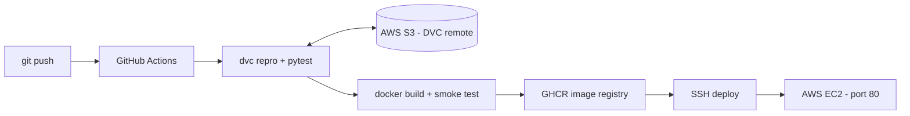

# Image Classification on AWS: DVC · Docker · GitHub Actions

A handwritten-digit classifier (0-9) with a complete MLOps workflow:

- **DVC** pipeline (`dvc.yaml`) that prepares data, trains and evaluates the model
- **FastAPI** web app: draw a digit or upload an image and get a prediction
- **Docker** image of the app (`Dockerfile`)
- **GitHub Actions** CI/CD (`.github/workflows/ci-cd.yaml`): reproduce pipeline, test, build image, deploy
- **AWS**: S3 as the DVC remote, EC2 to host the container (setup steps below)

Test accuracy of the current model: **97.2%** (360 held-out images).

## Workflow



DVC pipeline (`dvc dag`):

```
prepare  ->  preprocess  ->  train  ->  evaluate
PNG images   train/test       MLP        metrics.json +
per class    feature sets     model      confusion matrix
```

## Project structure

```
.
├── dvc.yaml                      # DVC pipeline definition
├── params.yaml                   # pipeline hyper-parameters
├── Dockerfile                    # container image of the app
├── .github/workflows/ci-cd.yaml  # GitHub Actions CI/CD
├── src/                          # prepare_data, preprocess, train, evaluate, imgproc
├── app/main.py                   # FastAPI application + web page
├── tests/                        # pytest suite (API + pre-processing)
├── requirements.txt              # runtime dependencies (Docker image)
└── requirements-train.txt        # + DVC, matplotlib, pytest (CI / development)
```

## Run locally

Python 3.12 is recommended (CI and Docker use it).

```bash
python -m venv .venv
source .venv/bin/activate          # Windows: .venv\Scripts\activate
pip install -r requirements-train.txt

dvc repro                          # runs the whole pipeline
dvc dag                            # shows the stages
dvc metrics show                   # shows accuracy / F1

pytest                             # run the tests
uvicorn app.main:app --reload      # open http://localhost:8000
```

## Run with Docker

The model must exist first (`dvc repro` or `dvc pull`).

```bash
docker build -t image-classifier .
docker run --rm -p 8000:8000 image-classifier
# open http://localhost:8000
```

## API

| Method | Path       | Description                                   |
|--------|------------|-----------------------------------------------|
| GET    | `/`        | Web page (draw a digit / upload an image)     |
| POST   | `/predict` | Multipart field `file` -> prediction + scores |
| GET    | `/health`  | Health check                                  |
| GET    | `/info`    | Model details and test metrics                |
| GET    | `/docs`    | Swagger UI                                    |

```bash
curl -F "file=@digit.png" http://localhost:8000/predict
```

## AWS setup (do this once, later)

Until the secrets below exist, the workflow still runs: the S3 and EC2 steps
are skipped automatically, so you can push to GitHub first.

### 1. S3 as the DVC remote

1. In the AWS console create an S3 bucket (for example in `ap-south-1`).
2. Create an IAM user with an access key and a policy limited to that bucket:

   ```json
   {
     "Version": "2012-10-17",
     "Statement": [
       { "Effect": "Allow", "Action": "s3:ListBucket",
         "Resource": "arn:aws:s3:::<your-bucket-name>" },
       { "Effect": "Allow",
         "Action": ["s3:GetObject", "s3:PutObject", "s3:DeleteObject"],
         "Resource": "arn:aws:s3:::<your-bucket-name>/*" }
     ]
   }
   ```

3. Make the credentials available locally (`aws configure`, or set
   `AWS_ACCESS_KEY_ID` / `AWS_SECRET_ACCESS_KEY`), then:

   ```bash
   dvc remote add -d s3remote s3://<your-bucket-name>/dvcstore
   dvc remote modify s3remote region ap-south-1
   dvc push
   git add .dvc/config && git commit -m "Add S3 DVC remote" && git push
   ```

### 2. EC2 instance

1. Launch an EC2 instance (Amazon Linux 2023, free-tier eligible type) and
   download the key pair (`.pem`).
2. Security group inbound rules: **SSH (22)** and **HTTP (80)**.
   GitHub-hosted runners have changing IPs, so SSH must be reachable from
   `0.0.0.0/0` for the automated deploy to work.
3. Connect once and install Docker:

   ```bash
   sudo dnf install -y docker
   sudo systemctl enable --now docker
   sudo usermod -aG docker ec2-user      # then log out and back in
   ```

### 3. GitHub repository secrets

*Settings -> Secrets and variables -> Actions -> New repository secret*

| Secret                  | Value                                          |
|-------------------------|------------------------------------------------|
| `AWS_ACCESS_KEY_ID`     | IAM user access key (enables DVC pull/push)    |
| `AWS_SECRET_ACCESS_KEY` | IAM user secret key                            |
| `AWS_REGION`            | optional, defaults to `ap-south-1`             |
| `EC2_HOST`              | EC2 public IPv4 address                        |
| `EC2_USER`              | optional, defaults to `ec2-user`               |
| `EC2_SSH_KEY`           | full contents of the `.pem` file               |

### 4. Deploy

Push to `main`. The workflow reproduces the pipeline, pushes data to S3,
builds and tests the image, publishes it to GitHub Container Registry
(`ghcr.io/<owner>/<repo>`) and starts it on EC2. Open
`http://<EC2 public IP>` to use the app.

## Screenshots to capture for the report

| Stage             | What to capture                                                 |
|-------------------|-----------------------------------------------------------------|
| DVC pipeline      | terminal: `dvc repro`, `dvc dag`, `dvc metrics show`            |
| GitHub Actions    | workflow run page with the three jobs (pipeline, docker, deploy)|
| AWS S3            | bucket contents (`dvcstore/`) after `dvc push`                  |
| Docker build      | terminal: `docker build`, `docker images`, `docker run`         |
| EC2 deployment    | EC2 instance details (public IP) and `docker ps` over SSH       |
| Application       | browser at `http://<EC2 public IP>` showing a prediction        |

---

Krisha Shah · PRN 24070126512
